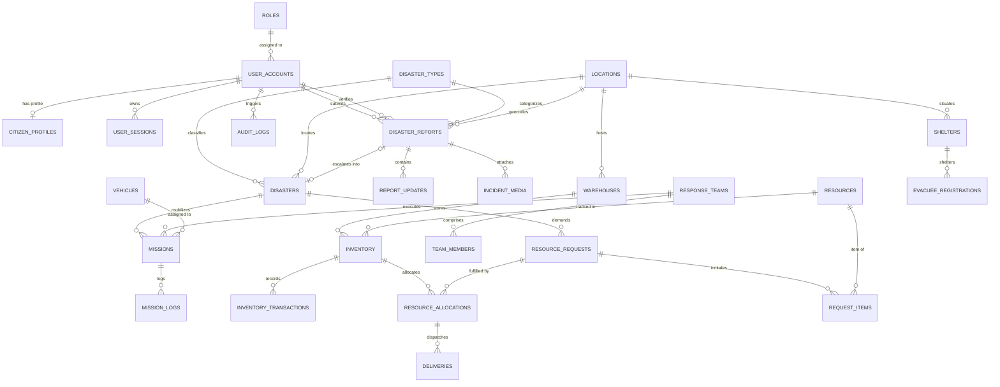

# ENTITY-RELATIONSHIP (ER) MODEL & DATA DICTIONARY
## Urban Disaster Response & Relief Coordination Platform (UDRRMS / UDR-ORP)

---

## 1. High-Resolution ER Diagram

The system ER diagram visualizes all 27 normalized relational entities across the five operational domains:

*(Generated at 300 DPI: `FINAL_PROJECT_REPORT/ER_DIAGRAM.png`)*

---

## 2. Mermaid ER Diagram Representation

---

## 3. Comprehensive Entity Relationship Matrix

| Parent Entity | Child Entity | Relationship | Foreign Key Column | Cascade Policy | Business Rule |
| :--- | :--- | :--- | :--- | :--- | :--- |
| `ROLES` | `USER_ACCOUNTS` | 1 : N | `role_id` | RESTRICT | A user must be assigned exactly one active authorization role. |
| `USER_ACCOUNTS` | `CITIZEN_PROFILES` | 1 : 1 | `user_id` | CASCADE | Extended citizen profile is deleted if the base user account is purged. |
| `DISASTER_TYPES` | `DISASTER_REPORTS` | 1 : N | `disaster_type_id` | RESTRICT | Report must reference a recognized disaster taxonomy code. |
| `LOCATIONS` | `DISASTER_REPORTS` | 1 : N | `location_id` | RESTRICT | Reports link to official city GIS wards for spatial clustering. |
| `USER_ACCOUNTS` | `DISASTER_REPORTS` | 1 : N | `reported_by_user_id` | RESTRICT | Preserves author attribution for all incoming distress calls. |
| `DISASTER_REPORTS` | `REPORT_UPDATES` | 1 : N | `report_id` | CASCADE | Supplementary telemetry logs belong to parent report record. |
| `DISASTER_REPORTS` | `DISASTERS` | 1 : 1 (opt) | `source_report_id` | SET NULL | Verifying a report activates an official disaster incident record. |
| `DISASTERS` | `MISSIONS` | 1 : N | `incident_id` | RESTRICT | Tactical missions operate under a designated active disaster incident. |
| `RESPONSE_TEAMS` | `MISSIONS` | 1 : N | `team_id` | RESTRICT | Prevents deletion of response teams currently engaged in active missions. |
| `MISSIONS` | `MISSION_LOGS` | 1 : N | `mission_id` | CASCADE | Operational logs and casualty extractions link directly to mission ID. |
| `WAREHOUSES` | `INVENTORY` | 1 : N | `warehouse_id` | CASCADE | Warehouse deletion clears internal depot ledger partitions. |
| `RESOURCES` | `INVENTORY` | 1 : N | `resource_id` | CASCADE | Master resource deletion cascades to inventory balance rows. |
| `INVENTORY` | `RESOURCE_ALLOCATIONS` | 1 : N | `inventory_id` | RESTRICT | Inventory rows cannot be deleted while active stock allocations exist. |
| `RESOURCE_REQUESTS`| `REQUEST_ITEMS` | 1 : N | `request_id` | CASCADE | Deleting a request removes its constituent supply line items. |
| `RESOURCE_ALLOCATIONS`| `DELIVERIES` | 1 : N | `allocation_id` | RESTRICT | Delivery transit records preserve allocation reference for audit. |
| `SHELTERS` | `EVACUEE_REGISTRATIONS`| 1 : N | `shelter_id` | RESTRICT | Shelters cannot be closed while evacuees remain registered on-site. |

---

## 4. Primary Key & Unique Constraint Strategy

1. **Surrogate Identifiers**: All entities utilize single-column integer identity primary keys (`GENERATED BY DEFAULT AS IDENTITY` in Oracle / `INTEGER PRIMARY KEY AUTOINCREMENT` in SQLite).
2. **Business Reference Keys**: In addition to surrogate IDs, operational entities receive human-readable, format-validated alphanumeric business reference keys:
   - Citizen Reports: `RPT-YYYYMMDD-XXXXXX` (Unique)
   - Official Disasters: `INC-YYYYMMDD-XXXXXX` (Unique)
   - Tactical Missions: `MIS-YYYYMMDD-XXXXXX` (Unique)
   - Supply Requests: `REQ-YYYYMMDD-XXXXXX` (Unique)
   - Dispatch Manifests: `DSP-YYYYMMDD-XXXXXX` (Unique)
3. **Composite Unique Constraints**: Junction tables enforce multi-column uniqueness:
   - `INVENTORY`: `UNIQUE(warehouse_id, resource_id)` prevents duplicate ledger entries for the same commodity at a single depot.
   - `USER_ACCOUNTS`: `UNIQUE(email)` guarantees distinct login credentials across the platform.

