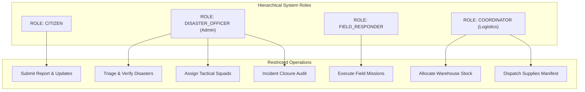

# ENTERPRISE SECURITY ARCHITECTURE & GOVERNANCE SPECIFICATION
## Urban Disaster Response & Relief Coordination Platform (UDRRMS / UDR-ORP)

---

## 1. Security Philosophy & Threat Model

The UDRRMS platform coordinates physical disaster rescue and logistics operations. A security failure could lead to unauthorized dispatch of emergency units, diversion of life-saving medical supplies, or falsification of disaster alerts. Consequently, security is engineered into every tier:

- **Confidentiality**: Protection of citizen distress records, medical notes, and emergency responder contact details.
- **Integrity**: Guaranteed immutability of audit logs and transactional ledger records.
- **Availability**: High-resilience endpoints designed to handle high transaction throughput during citywide disasters.
- **Accountability**: Complete non-repudiation; every state transition is stamped with the acting user's ID and timestamp.

---

## 2. Authentication & Credential Architecture

```
[Client Login Request]
       |
       v
(1) Pydantic Email & Password Validation
       |
       v
(2) Query USER_ACCOUNTS for Email
       |
       v
(3) Bcrypt Verification (Constant-Time String Comparison)
       |
       +---> [FAIL] ---> 401 Unauthorized (Generic "Invalid email or password")
       |
       +---> [PASS] ---> Issue Signed HMAC-SHA256 JWT Token
```

### 2.1 Password Storage: Salted Bcrypt
- **Algorithm**: `bcrypt` with random 128-bit salt per account.
- **Work Factor**: 12 iterations (computationally prohibitive against brute-force / GPU cracking).
- **Zero Plaintext Exposure**: Passwords are never saved in logs, transmitted in GET queries, or serialized in API responses.

### 2.2 Stateless HMAC-SHA256 JWT Tokens
- **Algorithm**: HS256 (HMAC with SHA-256).
- **Secret Key Management**: Loaded via server environment variables (`JWT_SECRET_KEY`), never hardcoded in source control.
- **Token Claims Payload**:
  ```json
  {
    "sub": "2",
    "email": "officer@udrrms.com",
    "role": "DISASTER_OFFICER",
    "exp": 1794354000,
    "iat": 1762770000
  }
  ```
- **Lifecycle & Invalidation**: Token expiration is strictly validated on every inbound request. Sign-out clears client token storage and drops the session.

---

## 3. Role-Based Access Control (RBAC) Enforcement

The platform enforces 4 distinct roles with strict privilege boundaries:



### 3.1 Role Privileges & Boundaries

| Operation / Endpoint Group | CITIZEN | DISASTER_OFFICER | FIELD_RESPONDER | COORDINATOR |
| :--- | :---: | :---: | :---: | :---: |
| Submit Disaster Report (`POST /reports`) | **ALLOW** | **ALLOW** | **DENY** | **DENY** |
| View Verification Queue (`GET /verification/queue`) | **DENY** | **ALLOW** | **DENY** | **DENY** |
| Verify / Reject Report (`POST /verification/*`) | **DENY** | **ALLOW** | **DENY** | **DENY** |
| Deploy Tactical Mission (`POST /missions`) | **DENY** | **ALLOW** | **DENY** | **DENY** |
| Update Mission Status (`PUT /missions/{id}/status`)| **DENY** | **DENY** | **ALLOW** | **DENY** |
| Request Mission Supplies (`POST /resources/requests`)| **DENY** | **ALLOW** | **ALLOW** | **DENY** |
| Allocate Warehouse Stock (`POST /resources/allocate`)| **DENY** | **DENY** | **DENY** | **ALLOW** |
| Replenish Stock Intake (`POST /resources/replenish`)| **DENY** | **DENY** | **DENY** | **ALLOW** |
| Closure Audit Sign-Off (`POST /incidents/{id}/close`)| **DENY** | **ALLOW** | **DENY** | **DENY** |

### 3.2 Backend Route Guard Implementation
Access control is implemented in Python FastAPI via Dependency Injection:
```python
def require_role(allowed_roles: list[str]):
    def role_checker(current_user: UserAccount = Depends(get_current_user)):
        if current_user.role.role_name not in allowed_roles:
            raise HTTPException(
                status_code=status.HTTP_403_FORBIDDEN,
                detail=f"Access denied: Requires one of {allowed_roles}"
            )
        return current_user
    return role_checker
```

---

## 4. Injection & Cross-Site Scripting (XSS) Defenses

### 4.1 SQL Injection Protection: 100% Parameterized
- **ORM**: All dynamic database queries utilize SQLAlchemy with bound parameters (`:param`).
- **Raw SQL Elimination**: No string interpolation, `f"SELECT ... {input}"`, or concatenation is utilized in any database-facing routine.
- **Database Engine Escaping**: The underlying database drivers (`cx_Oracle` / `sqlite3`) treat all user inputs as literal data values, nullifying SQL injection attacks.

### 4.2 Cross-Site Scripting (XSS) Protection
- **React Escaping**: React JSX automatically sanitizes and HTML-escapes all dynamic variables prior to rendering into the DOM.
- **Dangerous Directives Prohibited**: The frontend codebase contains zero usages of `dangerouslySetInnerHTML`.
- **Content Security Headers**: The Node.js Express gateway attaches strict security headers:
  ```http
  X-Content-Type-Options: nosniff
  X-Frame-Options: DENY
  X-XSS-Protection: 1; mode=block
  ```

---

## 5. Tamper-Evident Audit Logging

The platform maintains an immutable audit log (`AUDIT_LOGS`) recording every state-changing action:
- `audit_id`: Monotonically increasing sequence number.
- `user_id`: Authenticated user executing the transaction.
- `action`: Standardized verb (`VERIFY_REPORT`, `REJECT_REPORT`, `ASSIGN_MISSION`, `ALLOCATE_STOCK`, `DISPATCH_DELIVERY`, `CLOSE_INCIDENT`).
- `entity_name`: Target database table name.
- `entity_id`: Primary key of affected record.
- `details`: Human-readable summary of transition.
- `created_at`: High-precision UTC timestamp.

There are no APIs, controllers, or database procedures that permit updating or deleting existing audit logs.

